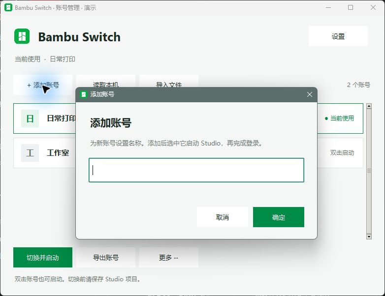

<p align="center"></p>

<h1 align="center">Bambu Switch</h1>

<p align="center">Keep a separate login session and settings for each Bambu Studio account.</p>

<p align="center"><a href="README.md">简体中文</a> · <strong>English</strong></p>

<p align="center">
  <a href="https://github.com/3356153957/bambu-switch/actions/workflows/build.yml"></a>
  <a href="LICENSE"></a>
  <a href="https://www.python.org/downloads/"></a>
  <a href="https://github.com/3356153957/bambu-switch/releases/latest"></a>
</p>

<p align="center"><a href="https://github.com/3356153957/bambu-switch/releases/latest">Download</a> · <a href="#quick-start">Quick start</a> · <a href="#development">Development</a></p>

<p align="center"></p>

Switching between Bambu Studio accounts can mean repeatedly signing out, signing in, and entering verification codes. Bambu Switch keeps each account's local configuration separate and launches Studio with the selected profile to reduce repeated sign-ins.

The screenshot shows the actual app in demo mode with fictional accounts. In demo mode, **读取本机** (Read local cache) only displays an explanation and does not read real Studio cache files. The application UI is currently in Chinese.

**New in v1.2.0:** a simpler account screen and application folder, consistent dialogs and menus, fixes for clipped text, local login cache detection, and `.bambu-account` file import/export. Existing account data stays in its original location when updating the EXE.

## Features

- **Separate profiles** for login sessions, printers, and slicer settings.
- **Quick switching** through the launch button or a double-click on an account card.
- **Local cache import** from the configuration and session Studio currently keeps on this computer. On first launch, a detected local session is imported automatically when Studio is closed.
- **Single-file sharing** by exporting a `.bambu-account` file for import on another computer. The recipient chooses when to launch Studio.
- **Desktop shortcuts** with the Bambu icon for individual accounts.
- **Backup and recovery** before initial setup and after interrupted switches.
- **Local operation** without administrator privileges. The switcher makes no network requests and does not parse passwords or login tokens.

Bambu Studio still handles authentication, cloud connections, and preset synchronization. Expired or revoked sessions require signing in again.
Everyday actions stay beside the account list. Installation, cache, profile, and backup folders are available under **设置** (Settings).

## Quick start

Requires **Windows 10 / 11 x64** and the stable release of Bambu Studio. Beta configuration directories are not managed.

1. Download `BambuAccountSwitcher-1.2.0-windows-x64.zip` from [Releases](https://github.com/3356153957/bambu-switch/releases/latest) and extract it to a permanent location.
2. Save your work, exit Bambu Studio, and run `BambuAccountSwitcher.exe`.
3. On first launch, a detected local login configuration is backed up and imported automatically. Click **读取本机** (Read local cache) to attempt a manual import of the current configuration.
4. Click **添加账号** (Add account) for another account, or **导入文件** (Import file) if you received a shared profile.
5. Select the profile and click **切换并启动** (Switch and launch). Complete Studio's first-run setup and sign in for a new account.

Select the desired account whenever you need it, or create a dedicated desktop shortcut. If you move the EXE, move the old shortcuts aside and recreate them.

**Adding an account only creates a profile. It does not automatically launch Studio or open its login dialog.** New profiles do not copy another account's session or networking plugin, so initial setup and plugin installation may be required.

## Local cache and account sharing

Clicking **读取本机** (Read local cache) attempts to import the configuration and session Studio currently stores locally, with an original backup kept first. A configuration already in the list is not imported again. It cannot recover a previous account after sign-out has removed its cache, or retrieve a cloud login history. Save your work and close Studio before reading or importing its configuration.

Select a profile, click **导出账号** (Export account), and save a `.bambu-account` file. The recipient can click **导入文件** (Import file) and choose it. Duplicate names receive a suffix; existing profiles are not overwritten. An existing local configuration remains active; if it was not previously managed, it is also backed up and preserved first. On a new computer with no local Studio configuration, the imported profile becomes active. None of these operations launches Studio automatically.

The shared file is not encrypted. It contains Studio configuration and may include a valid login session, printer details, access codes, and Studio plugins. Share it only with someone you authorize to use that account, and import files only from trusted sources. Whether a session works on another computer depends on Studio and server-side checks. Real-account cross-computer sign-in persistence has not been verified; a successful import does not confirm a successful login.

## Application folder

The extracted folder contains the executable, a short Chinese guide, and supporting files. Run the EXE directly and keep `support/` for the full documentation, screenshot, and license notices.

```text
BambuAccountSwitcher.exe        Application
使用说明.md                     Quick guide in Chinese
support/                        Full docs, screenshot, icons, and dependency licenses
```

Account data is stored outside the application folder. Moving or updating the EXE does not move profiles. **设置** (Settings) provides the Studio installation, active Studio cache, all profiles, and original backup folders; **更多** (More) provides the selected account's folder.

## Before switching

- Only one account can be used at a time; simultaneous sessions are not supported.
- The tool asks Studio to close normally. Handle any save prompt in Studio. Cancelling or timing out stops the switch.
- The current-profile label identifies local configuration; it does not verify cloud login status.
- Do not manually start or update Studio, edit configuration directories during a switch, or combine this tool with another profile manager.

## Data and privacy

Source and release archives exclude real accounts, printer access codes, session tokens, configuration backups, and development logs. Runtime data stays in the current operating-system user's directory.

```text
%APPDATA%/
├── BambuStudio/                 Active profile
└── BambuStudioSwitch/
    ├── state.json               Profile list and application path
    ├── pending.json             Recovery record during a switch
    ├── auto-import-disabled     Prevents automatic adoption after restoring normal use
    ├── profiles/<profile ID>/   Inactive profiles
    └── backups/<backup ID>/     Full backup before initial setup
```

Configuration, backups, and exported `.bambu-account` files may contain Studio login information. Do not publish them. Use **导出账号** (Export account) for sharing rather than archiving the runtime directory. The tool renames directories on the same volume, preserving data and stopping on conflicts, missing directories, or directory links.

<details>
<summary><strong>Stop managing profiles or restore the original configuration</strong></summary>

- **Stop management:** Exit Studio and click **恢复普通使用** (Restore normal use) in **设置** (Settings). The active account remains in the default directory; other profiles and backups remain in the data directory. Existing account shortcuts stop working. Automatic adoption stays disabled across app restarts. A successful manual import through **读取本机** (Read local cache) enables management and automatic adoption again.
- **Reconnect the previous list:** Before initializing again, exit both apps, keep a copy of the archived list, and rename the appropriate `state-detached-*.json` back to `state.json`.
- **Restore the original backup:** Exit both apps, rename the current `BambuStudio` directory to preserve it, copy the original backup to `%APPDATA%/BambuStudio`, and rename the entire `BambuStudioSwitch` directory to preserve it and prevent the old profile list from being used with the restored configuration.
- **Interrupted switch:** Exit Studio, then reopen the switcher. It attempts to finish or roll back the operation. If the directory layout is ambiguous, it stops; keep all data intact.

</details>

## Development

Requires Python 3.12+ with Tkinter. The application uses only the standard library.

```powershell
git clone https://github.com/3356153957/bambu-switch.git
cd bambu-switch
python app.py --demo  # Isolated temporary demo profiles
python app.py         # Normal use
python -m unittest -v
powershell -ExecutionPolicy Bypass -File .\build.ps1
```

Executables are written to `dist/<version>/`, alongside only `使用说明.md` and `support/`. Release and source archives are written to `output/`; older versions remain in their own directories. Release archives include dependency licenses. Both archives use explicit file lists and do not collect local account data. GitHub Actions runs tests, builds the application, and uploads build artifacts.

See [validation scope](VALIDATION.md) for tests and actual verification records. Simulated configurations cannot verify real-account session persistence, cross-computer sign-in, cloud connectivity, or printing.

## Credits and license

Inspired by the separate-profile and shortcut workflows in [c0ryd/bamboo-switch](https://github.com/c0ryd/bamboo-switch) and [Shotarrow2003/bambu-account-switcher](https://github.com/Shotarrow2003/bambu-account-switcher). The implementation is independently written. See [THIRD_PARTY.md](THIRD_PARTY.md) for attribution and verification details.

Original code and documentation are licensed under [MIT](LICENSE). Bambu icons and bundled dependencies retain their original licenses and ownership; see [third-party notices](THIRD_PARTY.md). This project is not affiliated with Bambu Lab.
