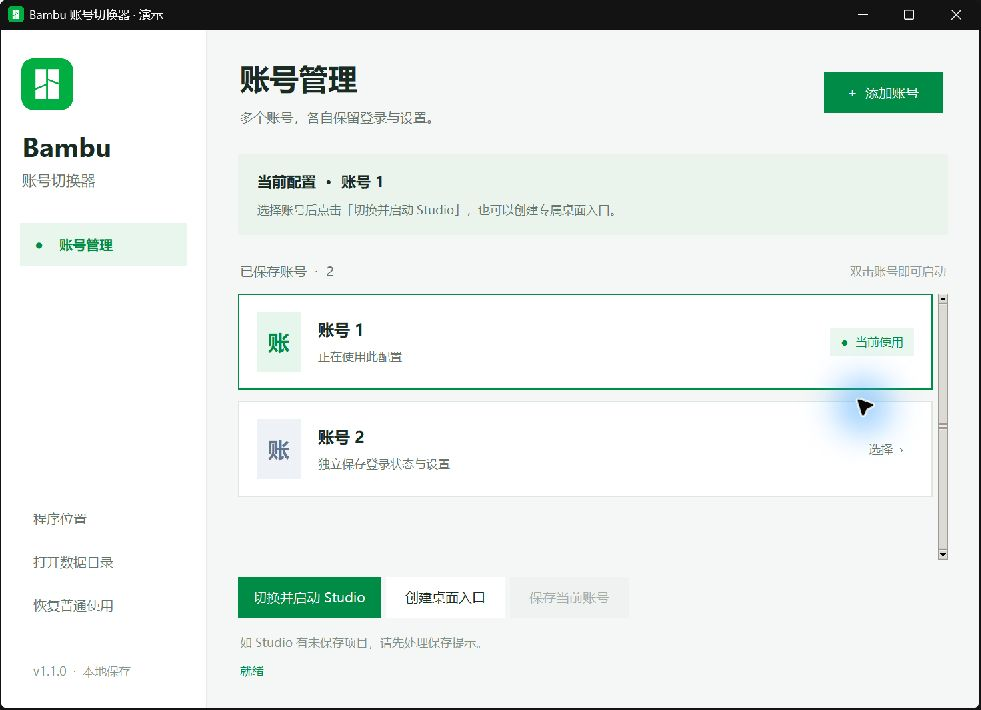

<p align="center"></p>

<h1 align="center">Bambu Switch</h1>

<p align="center">Keep a separate login session and settings for each Bambu Studio account.</p>

<p align="center"><a href="README.md">简体中文</a> · <strong>English</strong></p>

<p align="center">
  <a href="https://github.com/3356153957/bambu-switch/actions/workflows/build.yml"></a>
  <a href="LICENSE"></a>
  <a href="https://www.python.org/downloads/"></a>
  <a href="https://github.com/3356153957/bambu-switch/releases/latest"></a>
</p>

<p align="center"><a href="https://github.com/3356153957/bambu-switch/releases/latest">Download</a> · <a href="#quick-start">Quick start</a> · <a href="#development">Development</a></p>

<p align="center"></p>

Switching between Bambu Studio accounts can mean repeatedly signing out, signing in, and entering verification codes. Bambu Switch keeps each account's local configuration separate and launches Studio with the selected profile to reduce repeated sign-ins.

The screenshot shows the actual app in demo mode with fictional accounts. The application UI is currently in Chinese.

## Features

- **Separate profiles** for login sessions, printers, and slicer settings.
- **Quick switching** through the launch button or a double-click on an account card.
- **Desktop shortcuts** with the Bambu icon for individual accounts.
- **Backup and recovery** before initial setup and after interrupted switches.
- **Local operation** without administrator privileges. The switcher makes no network requests and does not parse passwords or login tokens.

Bambu Studio still handles authentication, cloud connections, and preset synchronization. Expired or revoked sessions require signing in again.

## Quick start

Requires **Windows 10 / 11 x64** and the stable release of Bambu Studio. Beta configuration directories are not managed.

1. Download `windows-x64.zip` from [Releases](https://github.com/3356153957/bambu-switch/releases/latest) and extract it to a permanent location.
2. Save your work, exit Bambu Studio, and run `BambuAccountSwitcher.exe`.
3. Click **保存当前账号** (Save current account), then name the existing profile. The tool backs up the original configuration first.
4. Click **添加账号** (Add account) to create a separate profile.
5. Select the new profile and click **切换并启动 Studio** (Switch and launch Studio). Complete Studio's first-run setup and sign in.

Select the desired account whenever you need it, or create a dedicated desktop shortcut. If you move the EXE, move the old shortcuts aside and recreate them.

**Adding an account only creates a profile. It does not automatically launch Studio or open its login dialog.** New profiles do not copy another account's session or networking plugin, so initial setup and plugin installation may be required.

## Before switching

- Only one account can be used at a time; simultaneous sessions are not supported.
- The tool asks Studio to close normally. Handle any save prompt in Studio. Cancelling or timing out stops the switch.
- The current-profile label identifies local configuration; it does not verify cloud login status.
- Do not manually start or update Studio, edit configuration directories during a switch, or combine this tool with another profile manager.

## Data and privacy

Source and release archives exclude real accounts, printer access codes, session tokens, configuration backups, and development logs. Runtime data stays in the current operating-system user's directory.

```text
%APPDATA%/
├── BambuStudio/                 Active profile
└── BambuStudioSwitch/
    ├── state.json               Profile list and application path
    ├── pending.json             Recovery record during a switch
    ├── profiles/<profile ID>/   Inactive profiles
    └── backups/<backup ID>/     Full backup before initial setup
```

Configuration and backups may contain Studio login information. Do not upload the runtime directory. The tool renames directories on the same volume, preserving data and stopping on conflicts, missing directories, or directory links.

<details>
<summary><strong>Stop managing profiles or restore the original configuration</strong></summary>

- **Stop management:** Exit Studio and click **恢复普通使用** (Restore normal use). The active account remains in the default directory; other profiles and backups remain in the data directory. Existing account shortcuts stop working.
- **Reconnect the previous list:** Before initializing again, exit both apps, keep a copy of the archived list, and rename the appropriate `state-detached-*.json` back to `state.json`.
- **Restore the original backup:** Exit both apps, rename the current `BambuStudio` directory to preserve it, copy the original backup to `%APPDATA%/BambuStudio`, and rename the entire `BambuStudioSwitch` directory to preserve it and prevent the old profile list from being used with the restored configuration.
- **Interrupted switch:** Exit Studio, then reopen the switcher. It attempts to finish or roll back the operation. If the directory layout is ambiguous, it stops; keep all data intact.

</details>

## Development

Requires Python 3.12+ with Tkinter. The application uses only the standard library.

```powershell
git clone https://github.com/3356153957/bambu-switch.git
cd bambu-switch
python app.py --demo  # Isolated temporary demo profiles
python app.py         # Normal use
python -m unittest -v
powershell -ExecutionPolicy Bypass -File .\build.ps1
```

Executables are written to `dist/<version>/`; release and source archives are written to `output/`. Release archives include dependency licenses. GitHub Actions runs tests, builds the application, and uploads build artifacts.

Tests cover simulated account switching, backups, writer locks, conflicts, interruption recovery, shortcut creation, and adding an account without automatically launching Studio. Real account persistence, cloud connectivity, and printing still require verification with actual devices. See [validation scope](VALIDATION.md).

## Credits and license

Inspired by the separate-profile and shortcut workflows in [c0ryd/bamboo-switch](https://github.com/c0ryd/bamboo-switch) and [Shotarrow2003/bambu-account-switcher](https://github.com/Shotarrow2003/bambu-account-switcher). The implementation is independently written. See [THIRD_PARTY.md](THIRD_PARTY.md) for attribution and verification details.

Original code and documentation are licensed under [MIT](LICENSE). Bambu icons and bundled dependencies retain their original licenses and ownership; see [third-party notices](THIRD_PARTY.md). This project is not affiliated with Bambu Lab.
