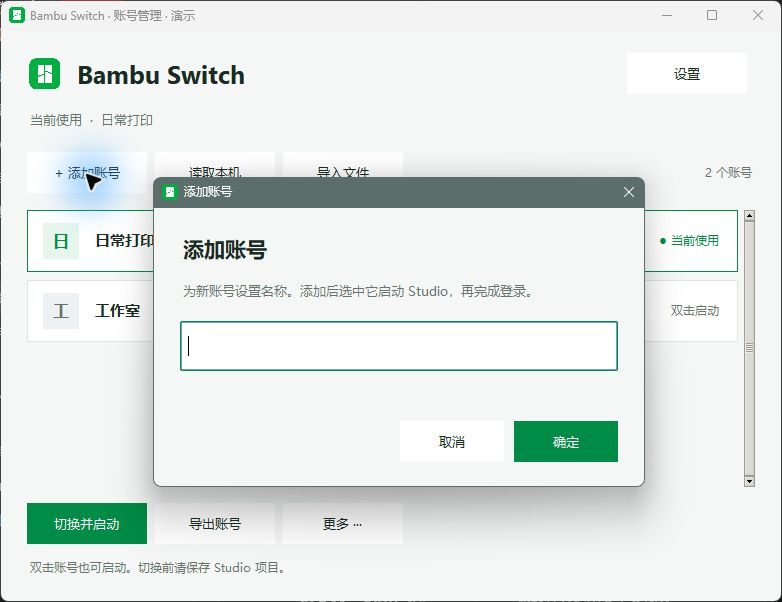

<p align="center"></p>

<h1 align="center">Bambu Switch</h1>

<p align="center">为每个 Bambu Studio 账号，保留独立的登录状态与设置。</p>

<p align="center"><strong>简体中文</strong> · <a href="README.en.md">English</a></p>

<p align="center">
  <a href="https://github.com/3356153957/bambu-switch/actions/workflows/build.yml"></a>
  <a href="LICENSE"></a>
  <a href="https://www.python.org/downloads/"></a>
  <a href="https://github.com/3356153957/bambu-switch/releases/latest"></a>
</p>

<p align="center"><a href="https://github.com/3356153957/bambu-switch/releases/latest">下载最新版</a> · <a href="#快速开始">快速开始</a> · <a href="#开发与构建">开发与构建</a></p>

<p align="center"></p>

在多个 Bambu Studio 账号之间切换时，反复退出、登录和输入验证码很麻烦。Bambu Switch 将各账号的本地配置分开保存，切换时启动对应配置，减少重复登录。

截图来自实际运行的演示模式，仅展示虚构账号。演示模式中的 **读取本机** 只展示说明，不读取真实的 Studio 缓存。当前软件界面为中文。

**v1.2.0 更新**：精简账号界面和软件目录，统一弹窗与菜单样式，修复文字遮挡；新增本机登录缓存读取和 `.bambu-account` 账号文件导入导出。已有账号数据继续保留在原位置，无需随 EXE 迁移。

## 主要功能

- **独立配置**：分别保存登录状态、打印机与切片设置。
- **快速切换**：选择账号后启动 Studio，也支持双击账号卡片。
- **读取本机**：发现本机 Studio 当前保存的登录配置；首次使用时，Studio 已退出且发现登录缓存会自动导入。
- **单文件分享**：将账号配置导出为 `.bambu-account` 文件，另一台电脑可直接导入，再由用户启动 Studio。
- **桌面入口**：为不同账号创建带拓竹图标的快捷方式。
- **备份与恢复**：首次接管前备份原配置，切换中断后尝试恢复。
- **本地运行**：切换器不请求网络，不解析密码或登录令牌，无需管理员权限。

Studio 自身的登录、云端连接与预设同步仍由 Bambu Studio 处理。登录过期或被服务端撤销后，需要重新登录。
界面将日常操作集中在账号列表；安装位置、缓存、账号和备份的目录入口统一放在 **设置** 中。

## 快速开始

支持 **Windows 10 / 11 x64** 与 Bambu Studio 正式版；不管理 Beta 版配置。

1. 从 [Releases](https://github.com/3356153957/bambu-switch/releases/latest) 下载 `BambuAccountSwitcher-1.2.0-windows-x64.zip`，解压到固定目录。
2. 保存工作并退出 Bambu Studio，然后运行 `BambuAccountSwitcher.exe`。
3. 首次启动发现本机保存的登录配置时，会先备份再自动导入；也可点击 **读取本机** 手动尝试导入当前配置。
4. 需要另一个账号时，点击 **添加账号**；已有分享文件时，点击 **导入文件**。
5. 选中账号，点击 **切换并启动**。新账号需完成 Studio 首次设置并登录。

以后选择需要的账号启动即可，也可为账号创建桌面入口。移动 EXE 后，需移走旧入口并重新创建。

**添加账号仅创建配置，不会自动启动 Studio 或打开登录界面。** 新配置不会复制旧账号的登录信息或网络插件，首次启动可能需要完成设置并安装插件。

## 读取本机与分享账号

点击 **读取本机** 会尝试导入本机 Studio 当前仍保存的配置和会话，成功前先保留原始备份；当前配置已在列表时，会实际检查缓存并显示结果，不会重复导入。曾经登录、后来退出且缓存已经清除的账号无法恢复；它也不会列出云端账号历史。Studio 正在运行时，先保存工作并退出，再进行读取或导入。

选中账号，点击 **导出账号**，保存一个 `.bambu-account` 文件；接收方点击 **导入文件** 并选择该文件即可添加到列表。同名账号会自动追加后缀，现有账号不被覆盖。已有本机配置时，导入会保留当前配置；尚未接管的本机配置也会先备份并保留。全新电脑没有本地 Studio 配置时，导入的账号会成为当前配置。以上操作都不会自动启动 Studio。

分享文件未加密，包含账号的 Studio 配置，可能包含仍有效的登录会话、打印机信息、访问码和 Studio 插件。只交给你允许使用该账号的人，并且只导入可信来源的文件。跨电脑能否继续免登录取决于 Studio 的会话有效性和服务端校验，尚未用真实账号完成跨机验证；导入成功不等于已登录成功。

## 软件目录

解压后只有程序、简明说明和配套文件目录，直接运行 EXE 即可。保留 `support/` 可查看完整说明、截图和许可。

```text
BambuAccountSwitcher.exe        启动程序
使用说明.md                     简明操作说明
support/                        完整说明、截图、图标与依赖许可
```

账号数据不保存在软件目录，移动或更新 EXE 不会迁移账号。**设置** 中可查看软件位置、指定 Studio 程序，并打开当前 Studio 缓存、全部账号和原始备份；所选账号的目录入口位于 **更多**。

## 使用须知

- 同一时间只使用一个账号，不支持多个账号并行运行。
- 切换时会请求 Studio 正常退出。出现未保存提示时，请在 Studio 中处理；取消关闭或超时后，不进行切换。
- “当前配置”指本地配置名称，不代表已核验云端登录状态。
- 不要在切换过程中手动启动 Studio、更新程序或改动配置目录，也不要与其他配置切换工具混用。

## 数据与隐私

源码和发布包不包含真实账号、打印机访问码、会话令牌、配置备份或开发日志。运行数据保存在系统用户目录。

```text
%APPDATA%/
├── BambuStudio/                 当前使用的配置
└── BambuStudioSwitch/
    ├── state.json               配置清单和程序位置
    ├── pending.json             切换过程中使用的恢复记录
    ├── auto-import-disabled     恢复普通使用后，阻止再次自动接管
    ├── profiles/<配置 ID>/      非当前账号的配置
    └── backups/<备份 ID>/       首次接管前的完整备份
```

配置、备份和导出的 `.bambu-account` 文件可能包含 Studio 登录信息，请勿公开上传。需要分享时使用 **导出账号**，不要打包整个运行数据目录。工具采用同盘目录重命名，遇到冲突、缺失或目录链接时停止操作并保留数据。

<details>
<summary><strong>恢复普通使用或原始配置</strong></summary>

- **停止管理**：先退出 Studio，在 **设置** 中点击 **恢复普通使用**。当前账号留在默认配置目录，其他账号与备份保留在数据目录。原桌面账号入口随后失效。自动接管也会持续停用，重启软件不会重新接管；需要再次管理时，手动点击 **读取本机** 并成功导入即可重新开启。
- **重新接回原清单**：在尚未再次初始化时，退出两款软件，保留归档副本，再将对应的 `state-detached-*.json` 恢复命名为 `state.json`。
- **恢复原始备份**：退出两款软件，将当前 `BambuStudio` 改名保存，把原始备份复制到 `%APPDATA%/BambuStudio`，并将整个 `BambuStudioSwitch` 改名保留，避免旧清单与恢复后的配置不匹配。
- **切换中断**：先退出 Studio，再打开工具。工具会尝试完成提交或回退；无法确认目录状态时会停止操作，请保留所有数据。

</details>

## 开发与构建

需要 Python 3.12+ 和 Tkinter。应用本身只使用标准库。

```powershell
git clone https://github.com/3356153957/bambu-switch.git
cd bambu-switch
python app.py --demo  # 使用隔离的临时演示配置
python app.py         # 正常使用
python -m unittest -v
powershell -ExecutionPolicy Bypass -File .\build.ps1
```

EXE 位于 `dist/<版本号>/`，同目录仅保留 `使用说明.md` 和 `support/` 配套文件。包含依赖许可的发布包和源码包位于 `output/`，旧版本保留在各自目录。发布包和源码包使用明确的文件清单，不收集本机账号数据。GitHub Actions 会运行测试、构建并上传构建产物。

测试和实际验证记录见 [验证范围](VALIDATION.md)。模拟配置验证不能代替真实账号登录保留、跨机免登录、云端连接和打印操作的验证。

## 致谢与许可

参考了 [c0ryd/bamboo-switch](https://github.com/c0ryd/bamboo-switch) 和 [Shotarrow2003/bambu-account-switcher](https://github.com/Shotarrow2003/bambu-account-switcher) 的独立配置与快捷入口思路，代码独立编写。来源、作者和核对记录见 [THIRD_PARTY.md](THIRD_PARTY.md)。

自行编写的代码与文档采用 [MIT](LICENSE)。拓竹图标及打包依赖保留原许可与归属，详见 [第三方说明](THIRD_PARTY.md)。本项目与 Bambu Lab 无隶属关系。
